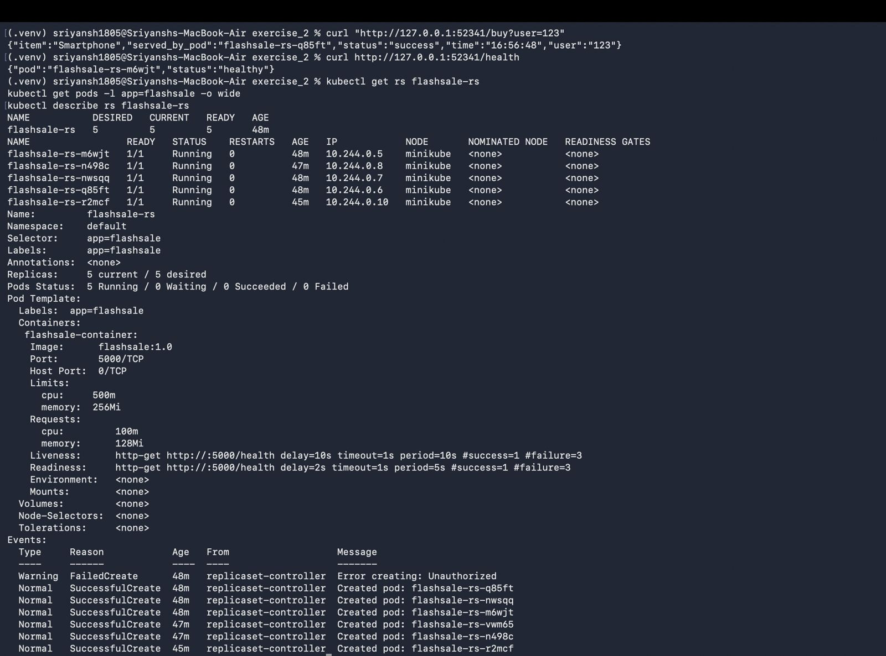

# Exercise 3 — Flash Sale App on a Kubernetes ReplicaSet

Run a multi-replica Flask "flash sale" app behind a ReplicaSet + ClusterIP Service, with health probes and resource limits. Each request is served by one of the pods, shown by the `pod` / `served_by_pod` field.

## Files

| File | Purpose |
|------|---------|
| `app.py` | Flask app with `/` (homepage), `/buy`, `/health` — each returns the serving pod's hostname |
| `Dockerfile` | Builds `flashsale:1.0` on `python:3.11-slim`, runs via gunicorn on port 5000 |
| `flashsale-replicaset.yaml` | ReplicaSet + ClusterIP Service `flashsale-svc` (port 80 → 5000) |

The ReplicaSet uses a readiness probe on `/health`, requests `100m` CPU / `128Mi`, limits `500m` CPU / `256Mi`.

## Steps

```bash
# Build the image into Minikube
eval $(minikube docker-env)
docker build -t flashsale:1.0 exercise_3/

# Deploy ReplicaSet + Service
kubectl apply -f exercise_3/flashsale-replicaset.yaml

# Scale replicas (manifest ships 3; scaled to 5 here)
kubectl scale rs flashsale-rs --replicas=5

# Inspect
kubectl get rs flashsale-rs
kubectl get pods -l app=flashsale -o wide
kubectl describe rs flashsale-rs

# Test endpoints (port-forward or minikube service to get a URL)
curl "http://127.0.0.1:52341/buy?user=123"
curl http://127.0.0.1:52341/health
```

## Result

```json
{"item":"Smartphone","served_by_pod":"flashsale-rs-q85ft","status":"success","time":"16:56:48","user":"123"}
{"pod":"flashsale-rs-m6wjt","status":"healthy"}
```

5/5 pods Running, each with its own IP on the node, load-balanced by the Service.

## Screenshot


