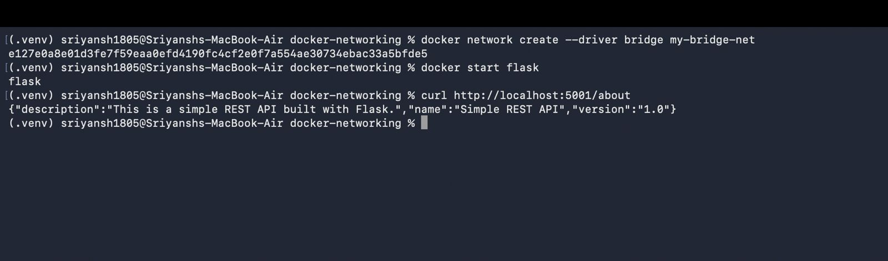
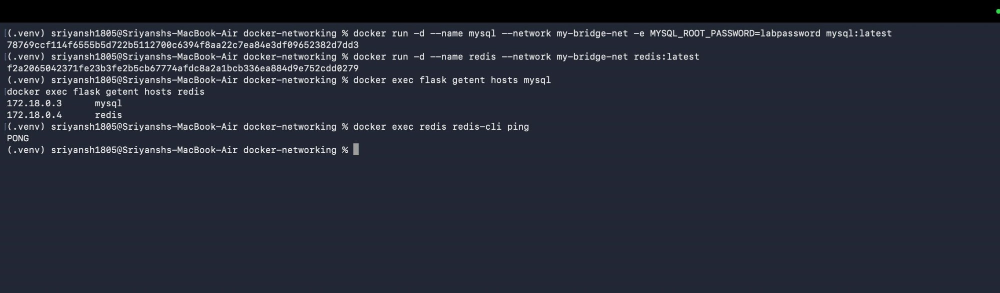
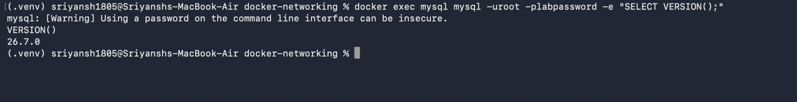
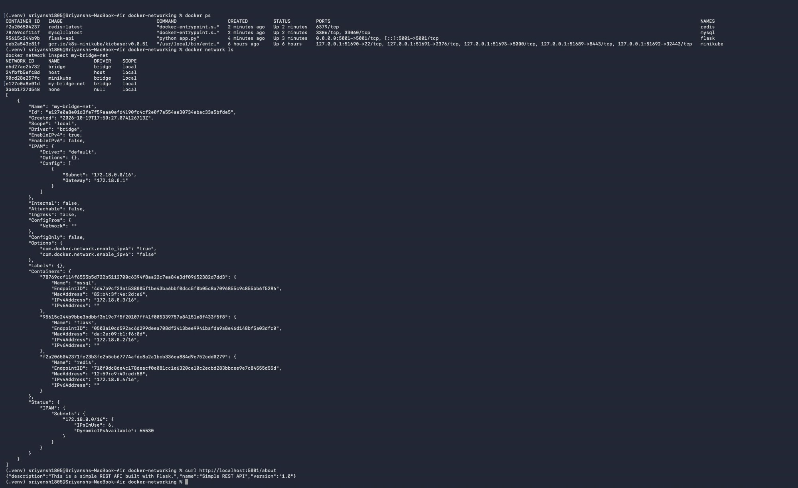

# Exercise 4 — Docker Networking (Custom Bridge, Multi-Container)

Connect a Flask REST API, MySQL, and Redis on a user-defined bridge network and verify container-to-container communication via Docker's built-in DNS.

## App files

`docker-networking/docker-networking/`

| File | Purpose |
|------|---------|
| `app.py` | Flask REST API, `GET /about` returns name/version/description, port 5001 |
| `Dockerfile` | Builds `flask-api` on `python:3.9-slim` |
| `requirements.txt` | Flask 2.0.1 + Werkzeug 2.0.3 |

## Steps

```bash
# Build the API image
cd docker-networking/docker-networking
docker build -t flask-api .

# Create a user-defined bridge network
docker network create --driver bridge my-bridge-net

# Run the Flask API on the network (host port 5001)
docker run -d --name flask --network my-bridge-net -p 5001:5001 flask-api
curl http://localhost:5001/about

# Run MySQL and Redis on the same network
docker run -d --name mysql --network my-bridge-net -e MYSQL_ROOT_PASSWORD=labpassword mysql:latest
docker run -d --name redis --network my-bridge-net redis:latest

# Verify DNS resolution by container name
docker exec flask getent hosts mysql
docker exec flask getent hosts redis
docker exec redis redis-cli ping

# Verify MySQL is up
docker exec mysql mysql -uroot -plabpassword -e "SELECT VERSION();"

# Inspect the network and attached containers
docker ps
docker network inspect my-bridge-net
```

## Result

- `curl /about` → `{"name":"Simple REST API","version":"1.0","description":"This is a simple REST API built with Flask."}`
- Containers resolve each other by name on subnet `172.18.0.0/16`: `mysql` → 172.18.0.3, `redis` → 172.18.0.4, `flask` → 172.18.0.2.
- `redis-cli ping` → `PONG`; MySQL `SELECT VERSION()` returns a version.

## Screenshots

**Flask Docker image build & initial API test**


**Multi-container networking & DNS resolution**


**MySQL database verification**


**Final multi-container configuration (`docker ps` + `network inspect`)**

