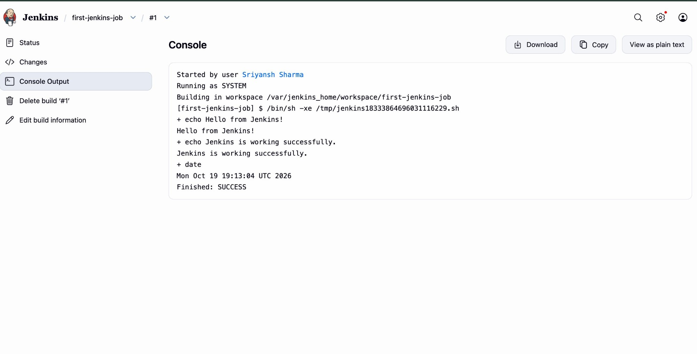

# Exercise 7 — First Jenkins Freestyle Job

Create a Jenkins **Freestyle** job that runs a shell build step to confirm Jenkins is working.

## Jenkins setup

1. **New Item** → name `first-jenkins-job` → **Freestyle project** → OK.
2. Under **Build Steps**, add **Execute shell**:
   ```bash
   echo "Hello from Jenkins!"
   echo "Jenkins is working successfully."
   date
   ```
3. Save and **Build Now**, then open **Console Output**.

## Result

```
+ echo Hello from Jenkins!
Hello from Jenkins!
+ echo Jenkins is working successfully.
Jenkins is working successfully.
+ date
Mon Oct 19 19:13:04 UTC 2026
Finished: SUCCESS
```

## Screenshot


