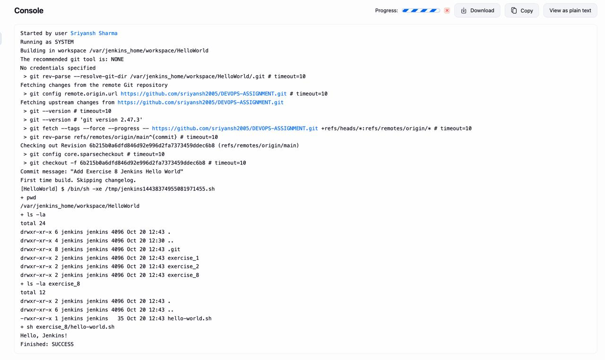

# Exercise 8 — Jenkins "Hello World" Pipeline

Run a simple shell script from this repo through a Jenkins freestyle/pipeline job.

## File

- `hello-world.sh` — prints `Hello, Jenkins!`

```bash
#!/bin/bash
echo "Hello, Jenkins!"
```

## Jenkins setup

1. Create a job that pulls this repo from Git (`https://github.com/sriyansh2005/DEVOPS-ASSIGNMENT.git`, branch `main`).
2. Add a build step **Execute shell**:
   ```bash
   sh exercise_8/hello-world.sh
   ```
3. Save and **Build Now**.

## Result

Jenkins checks out the repo into its workspace, runs the script, and the console output ends with:

```
Hello, Jenkins!
Finished: SUCCESS
```

## Screenshot


