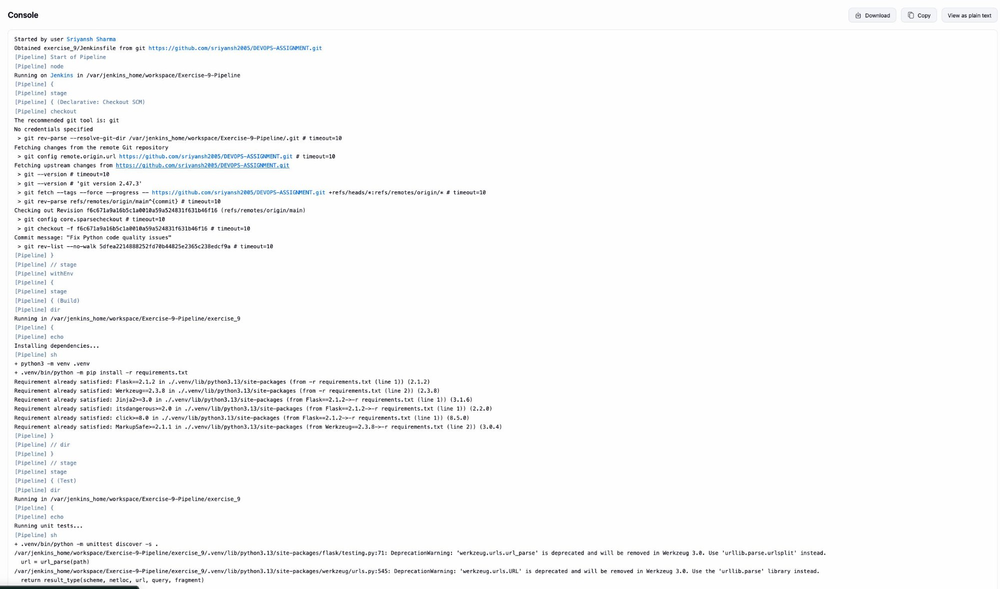
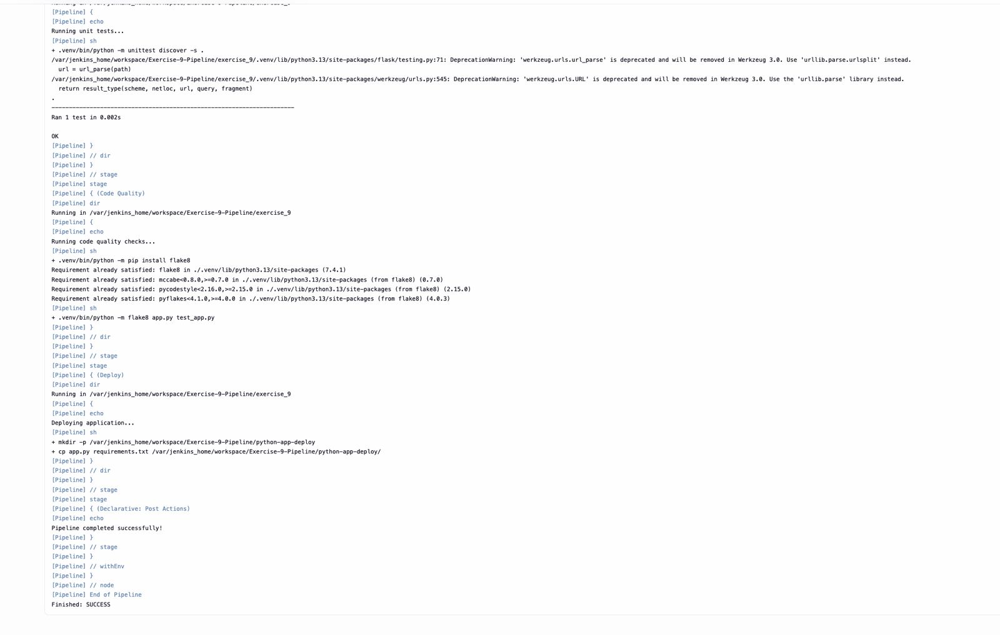

# Exercise 9 — Jenkins Multi-Stage Pipeline (Python/Flask)

A declarative Jenkins pipeline that builds, tests, lint-checks, and deploys a Flask app.

## Files

| File | Purpose |
|------|---------|
| `Jenkinsfile` | Declarative pipeline: Build → Test → Code Quality → Deploy |
| `app.py` | Flask app serving `Hello, Jenkins Multi-Stage Pipeline!` on port 5000 |
| `test_app.py` | `unittest` checking the `/` route returns 200 + expected body |
| `requirements.txt` | Flask + Werkzeug pins |

## Pipeline stages

1. **Build** — create a venv and `pip install -r requirements.txt`.
2. **Test** — `python -m unittest discover` runs `test_app.py`.
3. **Code Quality** — `flake8 app.py test_app.py`.
4. **Deploy** — copy `app.py` + `requirements.txt` into `${WORKSPACE}/python-app-deploy/`.

Post actions echo success/failure.

## Jenkins setup

1. Create a **Pipeline** job, set **Pipeline script from SCM** → Git.
2. Repo: `https://github.com/sriyansh2005/DEVOPS-ASSIGNMENT.git`, branch `main`.
3. Script path: `exercise_9/Jenkinsfile`.
4. **Build Now**.

## Result

All four stages pass:

```
Ran 1 test in 0.002s
OK
...
Pipeline completed successfully!
Finished: SUCCESS
```

## Screenshots




